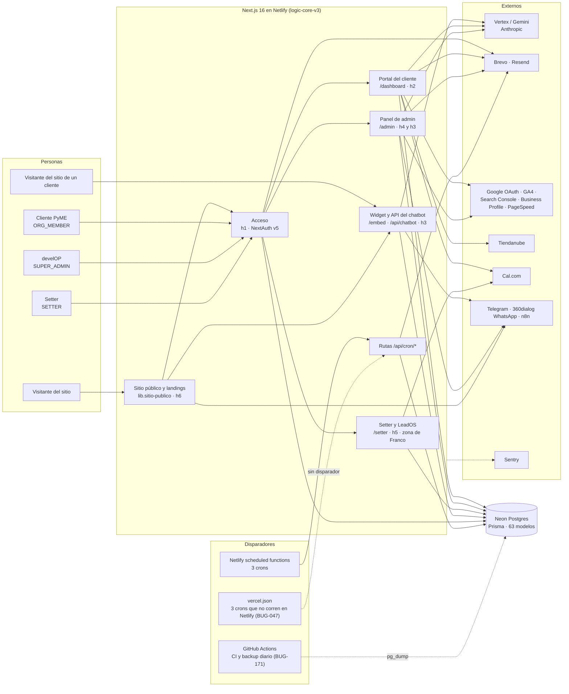

# Arquitectura

> Escrito a mano en F5 (auditoría 2026-10, base `57c421bc`) a partir de `atlas.json`, de la tabla de credenciales de `01-INVENTARIO.md` §6.1 (E10) y de los flujos trazados en F2. Si cambia la forma del sistema (una app nueva, otro hosting u otra base), se reescribe; los conteos finos están en `rutas.md`, `datos.md` y `dependencias.md`, que se regeneran.

## El sistema en una imagen

## Cómo fluyen los datos

- **Acceso.** Todas las zonas entran por NextAuth v5 (`src/auth.ts`, congelado y de Franco) con contraseña, magic link o Google. El proxy (`src/proxy.ts`) reparte por rol: SUPER_ADMIN → `/admin`, ORG_MEMBER → `/dashboard`, SETTER → `/setter`. La sesión lleva la organización del usuario, y cada lectura del portal debería filtrar por ella: `rutas.md` dice, entrada por entrada, si lo hace y con qué evidencia.
- **Chatbot.** El widget (`/embed/[slug]` y `public/widget.js`) habla con `/api/chatbot/[slug]/*`. Esa API arma el prompt con la base de conocimiento del bot, llama a Vertex/Gemini y guarda conversaciones, mensajes, leads y eventos en Neon pasando por el helper de aislamiento (`lib.isolation`). Los leads del chatbot llegan al portal del cliente (h3.cli-chatbot), al admin (h3.adm-chatbots) y, si el cliente lo configuró, a su CRM por n8n y a Telegram.
- **Portal del cliente.** Lee de Neon lo de su organización (proyecto, tickets, mensajes, plan, leads, resultados) y de las integraciones conectadas: GA4, Search Console, Google Business Profile, Tiendanube y Cal.com. Los resúmenes con IA (brief semanal, insights) se generan por cron y por demanda con Vertex o Anthropic.
- **Admin.** Opera sobre todas las organizaciones (clientes, proyectos, tickets, mensajes, chatbots, alertas y configuración). Es el único lugar con lecturas cross-tenant legítimas, por eso cada página exige SUPER_ADMIN (SEC-023: hoy lo hace solo el layout).
- **Setter y LeadOS.** Pipeline comercial interno: prospectos (`OsLead*`), agenda con Cal.com, manual del lead y revisión de demos. Todo es zona de Franco (`09-PARA-FRANCO.md`).
- **Crons.** Netlify dispara 3 scheduled functions que llaman a rutas `/api/cron/*` con `CRON_SECRET`: insights, reporte semanal y limpieza de eventos. Otros 3 crons están registrados solo en `vercel.json`, así que en Netlify no corren: reporte ejecutivo, briefs y follow-up de LeadOS (BUG-047). El detector de alertas no tiene ningún disparador (FAL-016).
- **Emails.** Brevo para transaccionales y marketing, Resend para avisos. Hay dos proveedores y varios remitentes (DEU-070).
- **Observabilidad.** Sentry recibe los errores de render y del chat. Las integraciones y los crons casi no reportan (FAL-029), y el SDK depende de `NEXT_PUBLIC_SENTRY_DSN` en el build (FAL-030).
- **Respaldo.** El workflow de backup diario nunca corrió por falta de secrets (BUG-171). La única red es la retención propia de Neon.

## Dónde mirar después

- Cada ruta con su auth, rol y tenant: `rutas.md`.
- El modelo de datos y quién lee y escribe cada tabla: `datos.md`.
- Qué módulo depende de cuál: `dependencias.md`.
- Una ficha por módulo, con «por dónde empezar»: `modulos/`.
- Ramas y worktrees: `ramas.md`.
- Las credenciales que vencen: `01-INVENTARIO.md` §6.1.
