# Datos

> GENERADO por `scripts/auditoria/atlas/vistas.mjs` desde `atlas.json` (57c421bc @ `57c421bc`, 2026-10-15). No se edita a mano: se regenera (ver `regenerar.md`).

63 modelos (control: 63). ERD por las relaciones de clave foránea (lado «uno» → lado «muchos»); los modelos sin relación no aparecen en el diagrama.

```mermaid
erDiagram
  User ||--o{ Account : "user"
  User ||--o{ Session : "user"
  User ||--o{ PasswordResetToken : "user"
  Subscription ||--o{ Organization : "subscription"
  ClientBrandProfile ||--o{ Organization : "brandProfile"
  BotConfig ||--o{ Organization : "botConfig"
  CrmIntegration ||--o{ Organization : "crmIntegration"
  ReferralCode ||--o{ Organization : "referralCode"
  Organization ||--o{ ExecutiveBriefSnapshot : "organization"
  Organization ||--o{ WeeklyReportLog : "organization"
  User ||--o{ OrgMember : "user"
  Organization ||--o{ OrgMember : "organization"
  Organization ||--o{ Service : "organization"
  Organization ||--o{ Project : "organization"
  OsLead ||--o{ Project : "osLead"
  Project ||--o{ Task : "project"
  User ||--o{ Task : "assignedTo"
  Organization ||--o{ Message : "organization"
  Organization ||--o{ Subscription : "organization"
  Plan ||--o{ Subscription : "plan"
  Plan ||--o{ Subscription : "pendingPlan"
  Organization ||--o{ Invoice : "organization"
  User ||--o{ Notification : "user"
  Organization ||--o{ Notification : "organization"
  Task ||--o{ Notification : "task"
  Organization ||--o{ ClientAsset : "organization"
  Organization ||--o{ ClientBrandProfile : "organization"
  Organization ||--o{ Ticket : "organization"
  User ||--o{ Ticket : "user"
  Ticket ||--o{ TicketMessage : "ticket"
  User ||--o{ TicketMessage : "user"
  Organization ||--o{ BusinessMetric : "organization"
  Organization ||--o{ PageView : "organization"
  Organization ||--o{ OnboardingTask : "organization"
  User ||--o{ OsLead : "assignedTo"
  OsLeadDossier ||--o{ OsLead : "dossier"
  Project ||--o{ OsLead : "project"
  OsLead ||--o{ OsLeadSetterMeta : "lead"
  User ||--o{ OsLeadSetterMeta : "setter"
  User ||--o{ OsSetterNotice : "setter"
  OsLead ||--o{ OsSetterNotice : "lead"
  OsLead ||--o{ OsLeadActivity : "lead"
  User ||--o{ OsLeadActivity : "performedBy"
  OsLead ||--o{ OsDemo : "lead"
  OsLead ||--o{ OsLeadDossier : "lead"
  Project ||--o{ OsPaymentMilestone : "project"
  Project ||--o{ OsMaintenancePayment : "project"
  Task ||--o{ OsTimeEntry : "task"
  Project ||--o{ OsTimeEntry : "project"
  User ||--o{ OsTimeEntry : "user"
  Organization ||--o{ OrganizationModule : "organization"
  PremiumModule ||--o{ OrganizationModule : "module"
  Organization ||--o{ EmailContact : "organization"
  Organization ||--o{ EmailCampaign : "organization"
  Organization ||--o{ BotConfig : "organization"
  KnowledgeBase ||--o{ BotConfig : "knowledgeBase"
  BotConfig ||--o{ KnowledgeBase : "botConfig"
  BotConfig ||--o{ Conversation : "botConfig"
  ChatbotLead ||--o{ Conversation : "lead"
  Conversation ||--o{ ChatMessage : "conversation"
  BotConfig ||--o{ ChatbotLead : "botConfig"
  Conversation ||--o{ ChatbotLead : "conversation"
  BotConfig ||--o{ ChatbotInsight : "botConfig"
  BotConfig ||--o{ QuotaUsage : "botConfig"
  BotConfig ||--o{ ChatbotEvent : "botConfig"
  Conversation ||--o{ ChatbotEvent : "conversation"
  BotConfig ||--o{ BotAlert : "botConfig"
  Organization ||--o{ CrmIntegration : "organization"
  ChatbotLead ||--o{ CrmSyncAttempt : "lead"
  CrmIntegration ||--o{ CrmSyncAttempt : "integration"
  Organization ||--o{ PanelAnnouncement : "organization"
  PanelAnnouncement ||--o{ PanelAnnouncementRead : "announcement"
  User ||--o{ PanelAnnouncementRead : "user"
  Organization ||--o{ ReferralCode : "organization"
  Organization ||--o{ Referral : "referrer"
  Organization ||--o{ Referral : "referred"
  Organization ||--o{ WabaChannel : "organization"
  Organization ||--o{ ContactIdentity : "organization"
  Organization ||--o{ MotorConversation : "organization"
  ContactIdentity ||--o{ MotorConversation : "contactIdentity"
  WabaChannel ||--o{ MotorConversation : "wabaChannel"
  Organization ||--o{ MotorMessage : "organization"
  MotorConversation ||--o{ MotorMessage : "conversation"
  Organization ||--o{ ContactIdentityTransition : "organization"
  ContactIdentity ||--o{ ContactIdentityTransition : "contactIdentity"
  Organization ||--o{ MotorTemplate : "organization"
  WabaChannel ||--o{ MotorTemplate : "wabaChannel"
  Organization ||--o{ MotorAlert : "organization"
  WabaChannel ||--o{ MotorAlert : "wabaChannel"
```

## Quién lee y escribe cada modelo

| Modelo | Campos | organizationId | Zona | Lo leen | Lo escriben |
|---|---|---|---|---|---|
| Account | 13 | no | congelado | — | — |
| AdminAuditLog | 13 | no | congelado | lib.audit-log-queries | lib.audit-log |
| AgencySettings | 16 | no | congelado | h4.adm-dashboard, h4.adm-config, h2.cli-mensajes, lib.alerts, int.telegram | h4.adm-config |
| BotAlert | 17 | no | congelado | h4.adm-shell, h4.adm-config, lib.chatbot.admin, h4.adm-alertas | lib.chatbot.admin, h4.adm-alertas |
| BotConfig | 42 | sí | congelado | h3.adm-actividad, h3.adm-chatbots, h4.adm-clientes, h4.adm-config, h3.cli-chatbot, h3.vis-api-chatbot, int.cron.generate-insights, h3.vis-widget-cliente, lib.bulk-actions, lib.isolation, lib.plan, h2.cli-resultados, lib.security, lib.chatbot.evals, lib.chatbot.admin, lib.chatbot.analysis, lib.chatbot.config, lib.chatbot.conversation, lib.chatbot.dashboard, lib.chatbot.health, lib.chatbot.insights, lib.chatbot.reports, lib.chatbot.tools | h3.adm-chatbots, h4.adm-clientes, lib.bulk-actions, lib.chatbot.evals, lib.chatbot.prisma, lib.chatbot.admin, lib.chatbot.dashboard |
| BusinessMetric | 8 | sí | congelado | lib.actions | lib.actions |
| ChatbotEvent | 10 | no | congelado | h4.adm-config, lib.chatbot.evals, lib.chatbot.admin, lib.chatbot.reports, lib.chatbot.tools | h3.vis-api-chatbot, lib.chatbot.evals, lib.chatbot.conversation, lib.chatbot.logging, lib.chatbot.reports |
| ChatbotInsight | 12 | no | congelado | lib.chatbot.analysis, lib.chatbot.insights | lib.chatbot.insights |
| ChatbotLead | 35 | no | congelado | h3.adm-chatbots, h2.cli-inicio, lib.bulk-actions, lib.chatbot.notifications, lib.isolation, h2.cli-resultados, h2.cli-reportes-email, lib.chatbot.evals, lib.chatbot.admin, h4.adm-clientes, lib.chatbot.analysis, lib.chatbot.conversation, lib.chatbot.crm, lib.chatbot.reports, lib.chatbot.scoring, lib.chatbot.tools | h3.adm-chatbots, h2.cli-resultados, lib.chatbot.evals, lib.chatbot.admin, lib.chatbot.conversation, lib.chatbot.logging, lib.chatbot.tools |
| ChatMessage | 9 | no | congelado | lib.chatbot.evals, lib.chatbot.admin, lib.chatbot.chat, lib.chatbot.reports, lib.chatbot.tools | lib.chatbot.chat, lib.chatbot.conversation |
| ClientAsset | 9 | sí | congelado | h4.adm-clientes, h2.cli-cuenta | lib.actions |
| ClientBrandProfile | 9 | sí | congelado | — | lib.actions, h2.cli-bienvenida |
| ContactIdentity | 11 | sí | congelado | lib.isolation, h3.vis-whatsapp | h3.vis-whatsapp |
| ContactIdentityTransition | 10 | sí | congelado | — | h3.vis-whatsapp |
| ContactSubmission | 12 | no | congelado | h4.adm-leads, h2.cli-servicios | h4.adm-leads, h6.vis-contacto, h2.cli-servicios |
| Conversation | 22 | no | congelado | h3.adm-chatbots, lib.isolation, lib.chatbot.evals, lib.chatbot.admin, h4.adm-clientes, lib.chatbot.conversation, lib.chatbot.insights, lib.chatbot.reports, lib.chatbot.tools | lib.chatbot.evals, lib.chatbot.chat, lib.chatbot.conversation, lib.chatbot.quota, lib.chatbot.tools |
| CrmIntegration | 16 | sí | congelado | lib.isolation, h3.adm-chatbots, h3.cli-chatbot, lib.chatbot.admin, lib.chatbot.crm | lib.chatbot.crm |
| CrmSyncAttempt | 13 | sí | congelado | lib.chatbot.admin | lib.chatbot.crm |
| EmailCampaign | 20 | sí | congelado | h2.cli-email-mkt | h2.cli-email-mkt |
| EmailContact | 13 | sí | congelado | h2.cli-email-mkt | h2.cli-email-mkt, h6.vis-optout |
| ExecutiveBriefSnapshot | 8 | sí | congelado | h2.cli-inicio | h2.cli-inicio |
| Invoice | 12 | sí | congelado | h2.cli-cuenta | — |
| KnowledgeBase | 12 | no | congelado | h3.cli-chatbot, lib.chatbot.admin | h4.adm-clientes, lib.chatbot.evals, lib.chatbot.prisma, lib.chatbot.admin |
| Message | 7 | sí | congelado | h4.adm-clientes, h4.adm-mensajes, h2.cli-shell, h2.cli-mensajes | lib.actions, h4.adm-mensajes, h2.cli-mensajes, h4.adm-proyectos |
| MotorAlert | 11 | sí | congelado | h3.vis-whatsapp | h3.vis-whatsapp |
| MotorConversation | 12 | sí | congelado | h3.vis-whatsapp | h3.vis-whatsapp |
| MotorMessage | 14 | sí | congelado | h3.vis-whatsapp | h3.vis-whatsapp |
| MotorTemplate | 13 | sí | congelado | h3.vis-whatsapp | h3.vis-whatsapp |
| Notification | 13 | sí | congelado | lib.actions, h2.cli-shell, lib.leados | lib.actions, h2.cli-shell, lib.leados, h2.cli-mensajes, h2.cli-servicios, h2.cli-referidos |
| OnboardingTask | 13 | sí | congelado | lib.actions, lib.componentes-dashboard | lib.actions, lib.onboarding |
| Organization | 76 | no | congelado | h4.adm-novedades, h3.adm-chatbots, h4.adm-clientes, h4.adm-mensajes, h4.adm-dashboard, h4.adm-proyectos, h2.cli-inicio, h2.cli-cuenta, h2.cli-shell, h2.cli-mensajes, h2.cli-agenda, h2.cli-email-mkt, h2.cli-resenas, h2.cli-tienda, h2.cli-resultados, int.gbp, int.tiendanube, int.cron.regenerate-briefs, h2.cli-reportes-email, h2.cli-bienvenida, h1.auth-impersonacion, h1.auth-invite, h4.adm-config, h2.cli-servicios, lib.alerts, lib.health-score, int.cal-com, lib.leados, h2.cli-referidos, h2.cli-soporte, lib.chatbot.admin, lib.chatbot.insights | lib.actions, h4.adm-clientes, h2.cli-inicio, h2.cli-cuenta, h2.cli-email-mkt, int.gbp, int.tiendanube, h2.cli-reportes-email, h2.cli-bienvenida, h1.auth-invite, lib.chatbot.evals, lib.chatbot.prisma, lib.chatbot.admin |
| OrganizationModule | 12 | sí | congelado | h4.adm-leads, h2.cli-shell, h2.cli-resenas, h2.cli-servicios, h2.cli-plan, lib.premium-modules | h2.cli-servicios, lib.premium-modules |
| OrgMember | 8 | sí | congelado | lib.actions, h2.cli-cuenta, h2.cli-resultados, lib.chatbot.notifications, int.email, lib.chatbot.admin | h2.cli-cuenta, h4.adm-clientes, h1.auth-invite, lib.chatbot.admin |
| OsDemo | 10 | no | congelado | h4.adm-dashboard | h4.adm-leads, lib.leados |
| OsLead | 27 | no | franco | h3.adm-chatbots, h5.adm-revision-demos, h4.adm-leads, h4.adm-dashboard, h4.adm-proyectos, h5.set-dia, h5.set-nuevo, lib.leados, h4.adm-clientes | h3.adm-chatbots, h4.adm-leads, h4.adm-proyectos, h5.set-dia, lib.leados |
| OsLeadActivity | 9 | no | franco | lib.leados | lib.leados |
| OsLeadDossier | 19 | no | franco | h5.adm-fg2lab, h4.adm-shell, h5.adm-revision-demos, lib.leados | lib.leados |
| OsLeadSetterMeta | 10 | no | franco | — | lib.leados |
| OsMaintenancePayment | 8 | no | congelado | h4.adm-dashboard, h4.adm-proyectos | h4.adm-proyectos |
| OsPaymentMilestone | 8 | no | congelado | h4.adm-proyectos | h4.adm-proyectos |
| OsSetterNotice | 10 | no | franco | lib.leados | lib.leados |
| OsTimeEntry | 13 | no | congelado | h4.adm-dashboard, h4.adm-equipo | h4.adm-proyectos, h4.adm-equipo |
| PageView | 6 | sí | congelado | lib.componentes-dashboard | int.tracking |
| PanelAnnouncement | 10 | sí | congelado | h4.adm-novedades, h2.cli-shell | h4.adm-novedades |
| PanelAnnouncementRead | 6 | no | congelado | — | h2.cli-shell |
| PasswordResetToken | 7 | no | congelado | h1.auth-invite, h1.auth-recupero | h1.auth-invite, h1.auth-recupero, h4.adm-config |
| Plan | 19 | no | congelado | h4.adm-clientes, lib.chatbot.evals | — |
| PremiumModule | 15 | no | congelado | h4.adm-config, h2.cli-servicios, lib.premium-modules | h4.adm-config |
| Project | 17 | sí | congelado | h4.adm-clientes, h4.adm-dashboard, h4.adm-proyectos, h2.cli-proyecto, h2.cli-resultados, lib.auth | h4.adm-proyectos |
| QuotaUsage | 14 | no | congelado | lib.plan, lib.chatbot.analysis | h4.adm-clientes, lib.chatbot.evals |
| RateLimit | 7 | no | congelado | — | — |
| Referral | 9 | no | congelado | h4.adm-referidos, h2.cli-referidos | h4.adm-referidos, h2.cli-referidos |
| ReferralCode | 5 | sí | congelado | h2.cli-referidos | h2.cli-referidos |
| Service | 6 | sí | congelado | h4.adm-proyectos, h2.cli-servicios, h2.cli-resultados, h2.cli-plan | h4.adm-proyectos, h4.adm-config |
| Session | 5 | no | congelado | — | — |
| Subscription | 18 | sí | congelado | h4.adm-clientes, h4.adm-dashboard, h2.cli-cuenta, lib.alerts, lib.plan, lib.subscription | h4.adm-clientes, lib.plan, lib.chatbot.evals |
| Task | 17 | no | congelado | lib.actions, h4.adm-proyectos, h4.adm-equipo, lib.health-score | lib.actions, h4.adm-proyectos, h4.adm-equipo |
| Ticket | 12 | sí | congelado | h4.adm-clientes, h4.adm-dashboard, h4.adm-tickets, h2.cli-soporte, lib.auth | h2.cli-soporte, h2.cli-cuenta, lib.auth |
| TicketMessage | 8 | no | congelado | — | h2.cli-soporte |
| User | 27 | no | congelado | lib.actions, h5.adm-revision-demos, h4.adm-leads, h4.adm-mensajes, h4.adm-proyectos, h4.adm-config, h4.adm-equipo, h2.cli-cuenta, h1.auth-invite, h4.adm-clientes, lib.leados, h1.auth-login, h1.auth-cambio, h1.auth-recupero, lib.auth, h2.cli-mensajes, h2.cli-servicios, h2.cli-referidos, lib.chatbot.admin | h4.adm-config, h2.cli-cuenta, h1.auth-invite, h4.adm-clientes, h1.auth-cambio, h1.auth-recupero, lib.chatbot.admin |
| VerificationToken | 3 | no | congelado | — | — |
| WabaChannel | 21 | sí | congelado | h3.vis-whatsapp | h3.vis-whatsapp |
| WeeklyReportLog | 12 | sí | congelado | h2.cli-reportes-email | h2.cli-reportes-email |
