# Dependencias

> GENERADO por `scripts/auditoria/atlas/vistas.mjs` desde `atlas.json` (57c421bc @ `57c421bc`, 2026-10-15). No se edita a mano: se regenera (ver `regenerar.md`). Grafo por módulo, no por archivo. Amarillo = ZONA-FRANCO; azul = congelado (restricción de la auditoría; ver `11-CONGELADOS.md`).

Se dibujan las 199 dependencias con 3 imports o más (de 686); la tabla completa va abajo.

```mermaid
flowchart LR
  classDef franco fill:#fde68a,stroke:#b45309,color:#111
  classDef congelado fill:#bfdbfe,stroke:#1d4ed8,color:#111
  lib_actions["lib.actions"]
  lib_prisma["lib.prisma"]
  lib_auth["lib.auth"]
  h4_adm_shell["h4.adm-shell"]
  lib_ui["lib.ui"]:::congelado
  lib_use_reduced_motion["lib.use-reduced-motion"]:::congelado
  h4_adm_alertas["h4.adm-alertas"]
  h4_adm_audit["h4.adm-audit"]
  h3_adm_chatbots["h3.adm-chatbots"]
  lib_chatbot_admin["lib.chatbot.admin"]
  lib_hover["lib.hover"]:::congelado
  h3_vis_widget_cliente["h3.vis-widget-cliente"]
  h4_adm_clientes["h4.adm-clientes"]
  lib_motion_variants["lib.motion-variants"]:::congelado
  lib_audit_log["lib.audit-log"]:::congelado
  h5_adm_fg2lab["h5.adm-fg2lab"]:::franco
  lib_leados["lib.leados"]:::franco
  h5_adm_revision_demos["h5.adm-revision-demos"]:::franco
  lib_utils["lib.utils"]:::congelado
  h4_adm_leads["h4.adm-leads"]
  lib_action_utils["lib.action-utils"]:::congelado
  lib_use_is_client["lib.use-is-client"]:::congelado
  h4_adm_mensajes["h4.adm-mensajes"]
  h4_adm_proyectos["h4.adm-proyectos"]
  h4_adm_equipo["h4.adm-equipo"]
  h4_adm_config["h4.adm-config"]
  lib_premium_features["lib.premium-features"]
  h4_adm_tickets["h4.adm-tickets"]
  h2_cli_inicio["h2.cli-inicio"]
  lib_preview["lib.preview"]
  h3_cli_chatbot["h3.cli-chatbot"]
  lib_chatbot["lib.chatbot"]
  lib_plan["lib.plan"]
  lib_chatbot_scoring["lib.chatbot.scoring"]
  lib_tz_ar["lib.tz-ar"]:::congelado
  h2_cli_cuenta["h2.cli-cuenta"]
  lib_componentes_dashboard["lib.componentes-dashboard"]
  h2_cli_shell["h2.cli-shell"]
  h2_cli_mensajes["h2.cli-mensajes"]
  h2_cli_agenda["h2.cli-agenda"]
  h2_cli_email_mkt["h2.cli-email-mkt"]
  h2_cli_resenas["h2.cli-resenas"]
  h2_cli_servicios["h2.cli-servicios"]
  int_gbp["int.gbp"]
  h2_cli_tienda["h2.cli-tienda"]
  lib_health_score["lib.health-score"]
  h2_cli_plan["h2.cli-plan"]
  h2_cli_proyecto["h2.cli-proyecto"]
  h2_cli_resultados["h2.cli-resultados"]
  int_search_console["int.search-console"]
  int_anthropic["int.anthropic"]
  int_ga4["int.ga4"]
  h2_cli_soporte["h2.cli-soporte"]
  h5_set_dia["h5.set-dia"]:::franco
  lib_dates_ar["lib.dates-ar"]:::congelado
  h5_set_lead["h5.set-lead"]:::franco
  lib_use_unsaved_guard["lib.use-unsaved-guard"]
  h5_set_manual["h5.set-manual"]:::franco
  lib_use_step_action["lib.use-step-action"]
  lib_chatbot_shared["lib.chatbot.shared"]
  lib_chatbot_llm["lib.chatbot.llm"]
  lib_security["lib.security"]
  int_email["int.email"]
  h1_auth_login["h1.auth-login"]
  h2_cli_reportes_email["h2.cli-reportes-email"]
  h3_vis_whatsapp["h3.vis-whatsapp"]
  lib_logger["lib.logger"]:::congelado
  h2_cli_bienvenida["h2.cli-bienvenida"]
  h1_auth_cambio["h1.auth-cambio"]
  lib_plataforma_app_raiz["lib.plataforma.app-raiz"]
  lib_sitio_publico["lib.sitio-publico"]
  lib_hooks["lib.hooks"]
  lib_whatsapp["lib.whatsapp"]
  lib_context["lib.context"]:::congelado
  lib_chatbot_lib["lib.chatbot.lib"]
  lib_data["lib.data"]
  lib_logo_footprint["lib.logo-footprint"]
  lib_chatbot_notifications["lib.chatbot.notifications"]
  lib_chatbot_analysis["lib.chatbot.analysis"]
  lib_chatbot_hooks["lib.chatbot.hooks"]
  lib_chatbot_evals["lib.chatbot.evals"]
  lib_isolation["lib.isolation"]
  lib_chatbot_config["lib.chatbot.config"]
  lib_chatbot_crm["lib.chatbot.crm"]
  lib_rate_limit["lib.rate-limit"]
  lib_chatbot_logging["lib.chatbot.logging"]
  lib_chatbot_conversation["lib.chatbot.conversation"]
  lib_chatbot_chat["lib.chatbot.chat"]
  lib_chatbot_insights["lib.chatbot.insights"]
  lib_chatbot_pricing["lib.chatbot.pricing"]
  lib_chatbot_tools["lib.chatbot.tools"]
  lib_chatbot_verticals["lib.chatbot.verticals"]
  lib_actions -->|6| lib_prisma
  lib_actions -->|8| lib_auth
  h4_adm_shell -->|3| lib_ui
  h4_adm_shell -->|3| lib_use_reduced_motion
  h4_adm_alertas -->|5| lib_ui
  h4_adm_audit -->|4| lib_ui
  h3_adm_chatbots -->|38| lib_ui
  h3_adm_chatbots -->|30| lib_chatbot_admin
  h3_adm_chatbots -->|5| h4_adm_shell
  h3_adm_chatbots -->|11| lib_auth
  h3_adm_chatbots -->|10| lib_prisma
  h3_adm_chatbots -->|6| lib_hover
  h3_adm_chatbots -->|7| h3_vis_widget_cliente
  h4_adm_clientes -->|15| lib_prisma
  h4_adm_clientes -->|23| lib_ui
  h4_adm_clientes -->|7| h4_adm_shell
  h4_adm_clientes -->|8| h3_adm_chatbots
  h4_adm_clientes -->|4| lib_motion_variants
  h4_adm_clientes -->|4| lib_use_reduced_motion
  h4_adm_clientes -->|10| lib_auth
  h4_adm_clientes -->|8| lib_audit_log
  h5_adm_fg2lab -->|3| lib_ui
  h5_adm_fg2lab -->|5| lib_leados
  h5_adm_revision_demos -->|6| lib_ui
  h5_adm_revision_demos -->|20| lib_leados
  h5_adm_revision_demos -->|4| lib_utils
  h5_adm_revision_demos -->|3| h4_adm_shell
  h5_adm_revision_demos -->|4| lib_prisma
  h4_adm_leads -->|8| lib_prisma
  h4_adm_leads -->|13| lib_leados
  h4_adm_leads -->|3| h4_adm_shell
  h4_adm_leads -->|3| lib_hover
  h4_adm_leads -->|7| lib_auth
  h4_adm_leads -->|6| lib_action_utils
  h4_adm_leads -->|14| lib_ui
  h4_adm_leads -->|7| lib_utils
  h4_adm_leads -->|4| lib_use_is_client
  h4_adm_leads -->|3| lib_use_reduced_motion
  h4_adm_mensajes -->|3| lib_ui
  h4_adm_proyectos -->|10| lib_ui
  h4_adm_proyectos -->|4| h4_adm_shell
  h4_adm_proyectos -->|10| lib_prisma
  h4_adm_proyectos -->|3| lib_hover
  h4_adm_proyectos -->|9| lib_auth
  h4_adm_proyectos -->|5| h4_adm_equipo
  h4_adm_proyectos -->|3| lib_action_utils
  h4_adm_config -->|5| lib_prisma
  h4_adm_config -->|7| lib_auth
  h4_adm_config -->|3| lib_premium_features
  h4_adm_config -->|6| lib_ui
  h4_adm_equipo -->|3| lib_prisma
  h4_adm_tickets -->|4| lib_ui
  h2_cli_inicio -->|10| lib_prisma
  h2_cli_inicio -->|5| lib_preview
  h3_cli_chatbot -->|36| lib_ui
  h3_cli_chatbot -->|14| lib_chatbot
  h3_cli_chatbot -->|3| h3_vis_widget_cliente
  h3_cli_chatbot -->|3| lib_prisma
  h3_cli_chatbot -->|10| lib_plan
  h3_cli_chatbot -->|5| lib_chatbot_scoring
  h3_cli_chatbot -->|4| lib_tz_ar
  h3_cli_chatbot -->|3| lib_preview
  h2_cli_cuenta -->|9| lib_ui
  h2_cli_cuenta -->|4| lib_prisma
  h2_cli_cuenta -->|3| lib_preview
  h2_cli_cuenta -->|10| lib_componentes_dashboard
  h2_cli_cuenta -->|3| lib_auth
  h2_cli_shell -->|4| lib_ui
  h2_cli_shell -->|3| lib_auth
  h2_cli_shell -->|4| lib_prisma
  h2_cli_shell -->|3| lib_componentes_dashboard
  h2_cli_mensajes -->|3| lib_prisma
  h2_cli_agenda -->|3| lib_ui
  h2_cli_email_mkt -->|3| lib_prisma
  h2_cli_email_mkt -->|4| lib_preview
  h2_cli_email_mkt -->|7| lib_ui
  h2_cli_resenas -->|4| h2_cli_servicios
  h2_cli_resenas -->|6| int_gbp
  h2_cli_resenas -->|3| lib_ui
  h2_cli_tienda -->|3| lib_ui
  h2_cli_inicio -->|7| lib_componentes_dashboard
  h2_cli_inicio -->|10| lib_ui
  h2_cli_inicio -->|4| lib_health_score
  h2_cli_inicio -->|6| lib_plan
  h2_cli_plan -->|4| lib_plan
  h2_cli_proyecto -->|3| lib_ui
  h2_cli_proyecto -->|6| lib_componentes_dashboard
  h2_cli_resultados -->|13| lib_ui
  h2_cli_resultados -->|5| lib_preview
  h2_cli_resultados -->|4| lib_plan
  h2_cli_resultados -->|14| lib_componentes_dashboard
  h2_cli_resultados -->|3| int_gbp
  h2_cli_resultados -->|5| lib_prisma
  h2_cli_resultados -->|4| int_search_console
  h2_cli_resultados -->|3| int_anthropic
  h2_cli_resultados -->|3| int_ga4
  h2_cli_servicios -->|3| lib_ui
  h2_cli_servicios -->|3| lib_componentes_dashboard
  h2_cli_servicios -->|3| lib_prisma
  h2_cli_soporte -->|4| lib_ui
  h2_cli_soporte -->|3| lib_prisma
  h2_cli_soporte -->|5| lib_auth
  h2_cli_soporte -->|3| lib_preview
  h2_cli_soporte -->|6| lib_componentes_dashboard
  h5_set_dia -->|10| lib_auth
  h5_set_dia -->|8| lib_action_utils
  h5_set_dia -->|59| lib_leados
  h5_set_dia -->|3| lib_dates_ar
  h5_set_dia -->|12| lib_ui
  h5_set_dia -->|11| lib_utils
  h5_set_lead -->|12| lib_ui
  h5_set_lead -->|22| lib_leados
  h5_set_lead -->|4| lib_use_unsaved_guard
  h5_set_lead -->|19| h5_set_dia
  h5_set_lead -->|4| h5_set_manual
  h5_set_manual -->|69| lib_leados
  h5_set_manual -->|16| h5_set_lead
  h5_set_manual -->|16| lib_ui
  h5_set_manual -->|36| h5_set_dia
  h5_set_manual -->|5| lib_use_step_action
  h5_set_manual -->|4| lib_use_unsaved_guard
  h5_set_manual -->|5| lib_utils
  h3_adm_chatbots -->|5| lib_chatbot_shared
  h3_adm_chatbots -->|5| lib_chatbot_llm
  h4_adm_clientes -->|4| lib_security
  h4_adm_clientes -->|5| lib_actions
  h4_adm_clientes -->|4| int_email
  h1_auth_login -->|3| lib_auth
  int_gbp -->|3| lib_prisma
  lib_leados -->|13| lib_prisma
  h3_cli_chatbot -->|5| lib_chatbot_admin
  h2_cli_reportes_email -->|5| lib_prisma
  h2_cli_reportes_email -->|7| int_email
  h3_vis_whatsapp -->|4| lib_logger
  h2_cli_bienvenida -->|3| lib_auth
  h1_auth_cambio -->|3| lib_ui
  lib_plataforma_app_raiz -->|5| lib_sitio_publico
  lib_sitio_publico -->|5| lib_hooks
  lib_sitio_publico -->|13| lib_whatsapp
  lib_sitio_publico -->|10| lib_ui
  lib_sitio_publico -->|7| lib_context
  lib_sitio_publico -->|11| lib_utils
  lib_componentes_dashboard -->|5| h2_cli_shell
  lib_componentes_dashboard -->|5| lib_utils
  lib_componentes_dashboard -->|12| lib_ui
  lib_componentes_dashboard -->|6| lib_hover
  lib_componentes_dashboard -->|6| lib_actions
  lib_componentes_dashboard -->|3| h3_adm_chatbots
  lib_componentes_dashboard -->|3| h2_cli_mensajes
  lib_componentes_dashboard -->|4| h2_cli_soporte
  lib_componentes_dashboard -->|3| lib_use_reduced_motion
  h2_cli_inicio -->|9| lib_utils
  h2_cli_inicio -->|6| lib_hover
  h2_cli_inicio -->|5| lib_dates_ar
  h2_cli_resultados -->|6| lib_chatbot_lib
  lib_sitio_publico -->|3| lib_data
  lib_ui -->|21| lib_utils
  lib_ui -->|3| lib_sitio_publico
  lib_ui -->|3| lib_logo_footprint
  lib_chatbot_notifications -->|3| int_email
  h4_adm_clientes -->|6| lib_chatbot_admin
  h2_cli_resultados -->|3| lib_chatbot_analysis
  h2_cli_reportes_email -->|4| h2_cli_inicio
  h2_cli_reportes_email -->|3| lib_tz_ar
  h3_vis_widget_cliente -->|24| lib_chatbot_shared
  h3_vis_widget_cliente -->|6| lib_chatbot_hooks
  h3_cli_chatbot -->|5| lib_utils
  h3_cli_chatbot -->|3| h3_adm_chatbots
  h3_cli_chatbot -->|3| lib_use_reduced_motion
  h3_cli_chatbot -->|3| lib_hover
  lib_chatbot_evals -->|4| lib_isolation
  lib_chatbot_hooks -->|5| lib_chatbot_shared
  lib_chatbot -->|3| lib_chatbot_config
  lib_chatbot -->|11| lib_chatbot_admin
  lib_chatbot -->|11| h3_vis_widget_cliente
  lib_chatbot -->|3| h3_adm_chatbots
  h4_adm_clientes -->|4| lib_isolation
  lib_chatbot_admin -->|23| lib_isolation
  lib_chatbot_admin -->|12| lib_audit_log
  lib_chatbot_admin -->|4| int_email
  lib_chatbot_admin -->|3| lib_chatbot_shared
  lib_chatbot_admin -->|4| h3_vis_widget_cliente
  lib_chatbot_admin -->|4| lib_chatbot_crm
  lib_chatbot_admin -->|6| lib_plan
  lib_chatbot_admin -->|6| lib_rate_limit
  lib_chatbot_admin -->|3| lib_chatbot_logging
  lib_chatbot_admin -->|4| lib_chatbot_conversation
  lib_chatbot_chat -->|5| lib_chatbot_shared
  lib_chatbot_chat -->|3| lib_chatbot_llm
  lib_chatbot_chat -->|4| lib_chatbot_logging
  lib_chatbot_insights -->|3| lib_isolation
  lib_chatbot_llm -->|5| lib_chatbot_shared
  lib_chatbot_pricing -->|6| lib_chatbot_llm
  lib_chatbot_tools -->|3| lib_isolation
  lib_chatbot_tools -->|3| lib_chatbot_logging
  lib_chatbot_tools -->|4| lib_chatbot_verticals
  lib_chatbot_tools -->|4| lib_chatbot_chat
  lib_chatbot_verticals -->|3| lib_chatbot_scoring
  h3_vis_whatsapp -->|9| lib_isolation
```

## Todas las dependencias entre módulos

| De | A | Imports |
|---|---|---|
| h5.set-manual | lib.leados | 69 |
| h5.set-dia | lib.leados | 59 |
| h3.adm-chatbots | lib.ui | 38 |
| h3.cli-chatbot | lib.ui | 36 |
| h5.set-manual | h5.set-dia | 36 |
| h3.adm-chatbots | lib.chatbot.admin | 30 |
| h3.vis-widget-cliente | lib.chatbot.shared | 24 |
| h4.adm-clientes | lib.ui | 23 |
| lib.chatbot.admin | lib.isolation | 23 |
| h5.set-lead | lib.leados | 22 |
| lib.ui | lib.utils | 21 |
| h5.adm-revision-demos | lib.leados | 20 |
| h5.set-lead | h5.set-dia | 19 |
| h5.set-manual | h5.set-lead | 16 |
| h5.set-manual | lib.ui | 16 |
| h4.adm-clientes | lib.prisma | 15 |
| h4.adm-leads | lib.ui | 14 |
| h3.cli-chatbot | lib.chatbot | 14 |
| h2.cli-resultados | lib.componentes-dashboard | 14 |
| h4.adm-leads | lib.leados | 13 |
| h2.cli-resultados | lib.ui | 13 |
| lib.leados | lib.prisma | 13 |
| lib.sitio-publico | lib.whatsapp | 13 |
| h5.set-dia | lib.ui | 12 |
| h5.set-lead | lib.ui | 12 |
| lib.componentes-dashboard | lib.ui | 12 |
| lib.chatbot.admin | lib.audit-log | 12 |
| h3.adm-chatbots | lib.auth | 11 |
| h5.set-dia | lib.utils | 11 |
| lib.sitio-publico | lib.utils | 11 |
| lib.chatbot | lib.chatbot.admin | 11 |
| lib.chatbot | h3.vis-widget-cliente | 11 |
| h3.adm-chatbots | lib.prisma | 10 |
| h4.adm-clientes | lib.auth | 10 |
| h4.adm-proyectos | lib.ui | 10 |
| h4.adm-proyectos | lib.prisma | 10 |
| h2.cli-inicio | lib.prisma | 10 |
| h3.cli-chatbot | lib.plan | 10 |
| h2.cli-cuenta | lib.componentes-dashboard | 10 |
| h2.cli-inicio | lib.ui | 10 |
| h5.set-dia | lib.auth | 10 |
| lib.sitio-publico | lib.ui | 10 |
| h4.adm-proyectos | lib.auth | 9 |
| h2.cli-cuenta | lib.ui | 9 |
| h2.cli-inicio | lib.utils | 9 |
| h3.vis-whatsapp | lib.isolation | 9 |
| lib.actions | lib.auth | 8 |
| h4.adm-clientes | h3.adm-chatbots | 8 |
| h4.adm-clientes | lib.audit-log | 8 |
| h4.adm-leads | lib.prisma | 8 |
| h5.set-dia | lib.action-utils | 8 |
| h3.adm-chatbots | h3.vis-widget-cliente | 7 |
| h4.adm-clientes | h4.adm-shell | 7 |
| h4.adm-leads | lib.auth | 7 |
| h4.adm-leads | lib.utils | 7 |
| h4.adm-config | lib.auth | 7 |
| h2.cli-email-mkt | lib.ui | 7 |
| h2.cli-inicio | lib.componentes-dashboard | 7 |
| h2.cli-reportes-email | int.email | 7 |
| lib.sitio-publico | lib.context | 7 |
| lib.actions | lib.prisma | 6 |
| h3.adm-chatbots | lib.hover | 6 |
| h5.adm-revision-demos | lib.ui | 6 |
| h4.adm-leads | lib.action-utils | 6 |
| h4.adm-config | lib.ui | 6 |
| h2.cli-resenas | int.gbp | 6 |
| h2.cli-inicio | lib.plan | 6 |
| h2.cli-proyecto | lib.componentes-dashboard | 6 |
| h2.cli-soporte | lib.componentes-dashboard | 6 |
| lib.componentes-dashboard | lib.hover | 6 |
| lib.componentes-dashboard | lib.actions | 6 |
| h2.cli-inicio | lib.hover | 6 |
| h2.cli-resultados | lib.chatbot.lib | 6 |
| h4.adm-clientes | lib.chatbot.admin | 6 |
| h3.vis-widget-cliente | lib.chatbot.hooks | 6 |
| lib.chatbot.admin | lib.plan | 6 |
| lib.chatbot.admin | lib.rate-limit | 6 |
| lib.chatbot.pricing | lib.chatbot.llm | 6 |
| h4.adm-alertas | lib.ui | 5 |
| h3.adm-chatbots | h4.adm-shell | 5 |
| h5.adm-fg2lab | lib.leados | 5 |
| h4.adm-proyectos | h4.adm-equipo | 5 |
| h4.adm-config | lib.prisma | 5 |
| h2.cli-inicio | lib.preview | 5 |
| h3.cli-chatbot | lib.chatbot.scoring | 5 |
| h2.cli-resultados | lib.preview | 5 |
| h2.cli-resultados | lib.prisma | 5 |
| h2.cli-soporte | lib.auth | 5 |
| h5.set-manual | lib.use-step-action | 5 |
| h5.set-manual | lib.utils | 5 |
| h3.adm-chatbots | lib.chatbot.shared | 5 |
| h3.adm-chatbots | lib.chatbot.llm | 5 |
| h4.adm-clientes | lib.actions | 5 |
| h3.cli-chatbot | lib.chatbot.admin | 5 |
| h2.cli-reportes-email | lib.prisma | 5 |
| lib.plataforma.app-raiz | lib.sitio-publico | 5 |
| lib.sitio-publico | lib.hooks | 5 |
| lib.componentes-dashboard | h2.cli-shell | 5 |
| lib.componentes-dashboard | lib.utils | 5 |
| h2.cli-inicio | lib.dates-ar | 5 |
| h3.cli-chatbot | lib.utils | 5 |
| lib.chatbot.hooks | lib.chatbot.shared | 5 |
| lib.chatbot.chat | lib.chatbot.shared | 5 |
| lib.chatbot.llm | lib.chatbot.shared | 5 |
| h4.adm-audit | lib.ui | 4 |
| h4.adm-clientes | lib.motion-variants | 4 |
| h4.adm-clientes | lib.use-reduced-motion | 4 |
| h5.adm-revision-demos | lib.utils | 4 |
| h5.adm-revision-demos | lib.prisma | 4 |
| h4.adm-leads | lib.use-is-client | 4 |
| h4.adm-proyectos | h4.adm-shell | 4 |
| h4.adm-tickets | lib.ui | 4 |
| h3.cli-chatbot | lib.tz-ar | 4 |
| h2.cli-cuenta | lib.prisma | 4 |
| h2.cli-shell | lib.ui | 4 |
| h2.cli-shell | lib.prisma | 4 |
| h2.cli-email-mkt | lib.preview | 4 |
| h2.cli-resenas | h2.cli-servicios | 4 |
| h2.cli-inicio | lib.health-score | 4 |
| h2.cli-plan | lib.plan | 4 |
| h2.cli-resultados | lib.plan | 4 |
| h2.cli-resultados | int.search-console | 4 |
| h2.cli-soporte | lib.ui | 4 |
| h5.set-lead | lib.use-unsaved-guard | 4 |
| h5.set-lead | h5.set-manual | 4 |
| h5.set-manual | lib.use-unsaved-guard | 4 |
| h4.adm-clientes | lib.security | 4 |
| h4.adm-clientes | int.email | 4 |
| h3.vis-whatsapp | lib.logger | 4 |
| lib.componentes-dashboard | h2.cli-soporte | 4 |
| h2.cli-reportes-email | h2.cli-inicio | 4 |
| lib.chatbot.evals | lib.isolation | 4 |
| h4.adm-clientes | lib.isolation | 4 |
| lib.chatbot.admin | int.email | 4 |
| lib.chatbot.admin | h3.vis-widget-cliente | 4 |
| lib.chatbot.admin | lib.chatbot.crm | 4 |
| lib.chatbot.admin | lib.chatbot.conversation | 4 |
| lib.chatbot.chat | lib.chatbot.logging | 4 |
| lib.chatbot.tools | lib.chatbot.verticals | 4 |
| lib.chatbot.tools | lib.chatbot.chat | 4 |
| h4.adm-shell | lib.ui | 3 |
| h4.adm-shell | lib.use-reduced-motion | 3 |
| h5.adm-fg2lab | lib.ui | 3 |
| h5.adm-revision-demos | h4.adm-shell | 3 |
| h4.adm-leads | h4.adm-shell | 3 |
| h4.adm-leads | lib.hover | 3 |
| h4.adm-leads | lib.use-reduced-motion | 3 |
| h4.adm-mensajes | lib.ui | 3 |
| h4.adm-proyectos | lib.hover | 3 |
| h4.adm-proyectos | lib.action-utils | 3 |
| h4.adm-config | lib.premium-features | 3 |
| h4.adm-equipo | lib.prisma | 3 |
| h3.cli-chatbot | h3.vis-widget-cliente | 3 |
| h3.cli-chatbot | lib.prisma | 3 |
| h3.cli-chatbot | lib.preview | 3 |
| h2.cli-cuenta | lib.preview | 3 |
| h2.cli-cuenta | lib.auth | 3 |
| h2.cli-shell | lib.auth | 3 |
| h2.cli-shell | lib.componentes-dashboard | 3 |
| h2.cli-mensajes | lib.prisma | 3 |
| h2.cli-agenda | lib.ui | 3 |
| h2.cli-email-mkt | lib.prisma | 3 |
| h2.cli-resenas | lib.ui | 3 |
| h2.cli-tienda | lib.ui | 3 |
| h2.cli-proyecto | lib.ui | 3 |
| h2.cli-resultados | int.gbp | 3 |
| h2.cli-resultados | int.anthropic | 3 |
| h2.cli-resultados | int.ga4 | 3 |
| h2.cli-servicios | lib.ui | 3 |
| h2.cli-servicios | lib.componentes-dashboard | 3 |
| h2.cli-servicios | lib.prisma | 3 |
| h2.cli-soporte | lib.prisma | 3 |
| h2.cli-soporte | lib.preview | 3 |
| h5.set-dia | lib.dates-ar | 3 |
| h1.auth-login | lib.auth | 3 |
| int.gbp | lib.prisma | 3 |
| h2.cli-bienvenida | lib.auth | 3 |
| h1.auth-cambio | lib.ui | 3 |
| lib.componentes-dashboard | h3.adm-chatbots | 3 |
| lib.componentes-dashboard | h2.cli-mensajes | 3 |
| lib.componentes-dashboard | lib.use-reduced-motion | 3 |
| lib.sitio-publico | lib.data | 3 |
| lib.ui | lib.sitio-publico | 3 |
| lib.ui | lib.logo-footprint | 3 |
| lib.chatbot.notifications | int.email | 3 |
| h2.cli-resultados | lib.chatbot.analysis | 3 |
| h2.cli-reportes-email | lib.tz-ar | 3 |
| h3.cli-chatbot | h3.adm-chatbots | 3 |
| h3.cli-chatbot | lib.use-reduced-motion | 3 |
| h3.cli-chatbot | lib.hover | 3 |
| lib.chatbot | lib.chatbot.config | 3 |
| lib.chatbot | h3.adm-chatbots | 3 |
| lib.chatbot.admin | lib.chatbot.shared | 3 |
| lib.chatbot.admin | lib.chatbot.logging | 3 |
| lib.chatbot.chat | lib.chatbot.llm | 3 |
| lib.chatbot.insights | lib.isolation | 3 |
| lib.chatbot.tools | lib.isolation | 3 |
| lib.chatbot.tools | lib.chatbot.logging | 3 |
| lib.chatbot.verticals | lib.chatbot.scoring | 3 |
| lib.actions | int.email | 2 |
| h4.adm-shell | lib.sitio-publico | 2 |
| h4.adm-shell | lib.use-is-client | 2 |
| h4.adm-alertas | lib.use-reduced-motion | 2 |
| h4.adm-novedades | lib.prisma | 2 |
| h4.adm-audit | lib.use-is-client | 2 |
| h4.adm-audit | lib.audit-log-queries | 2 |
| h3.adm-actividad | lib.ui | 2 |
| h3.adm-actividad | lib.chatbot.admin | 2 |
| h3.adm-actividad | h3.adm-chatbots | 2 |
| h3.adm-health | lib.ui | 2 |
| h3.adm-health | lib.chatbot.health | 2 |
| h3.adm-chatbots | lib.audit-log | 2 |
| h3.adm-chatbots | int.email | 2 |
| h3.adm-chatbots | lib.chatbot.conversation | 2 |
| h3.adm-chatbots | h3.cli-chatbot | 2 |
| h3.adm-chatbots | lib.chatbot | 2 |
| h4.adm-clientes | lib.chatbot.shared | 2 |
| h5.adm-revision-demos | lib.hover | 2 |
| h4.adm-leads | h2.cli-servicios | 2 |
| h4.adm-mensajes | lib.prisma | 2 |
| h4.adm-mensajes | h4.adm-shell | 2 |
| h4.adm-proyectos | lib.use-is-client | 2 |
| h4.adm-referidos | lib.prisma | 2 |
| h4.adm-config | lib.agency-settings | 2 |
| h4.adm-config | lib.mask-secret | 2 |
| h4.adm-equipo | lib.auth | 2 |
| h4.adm-equipo | lib.action-utils | 2 |
| h4.adm-equipo | lib.ui | 2 |
| h4.adm-tickets | h4.adm-shell | 2 |
| h4.adm-tickets | lib.utils | 2 |
| h4.adm-tickets | h2.cli-soporte | 2 |
| h2.cli-inicio | lib.auth | 2 |
| h2.cli-cuenta | lib.utils | 2 |
| h2.cli-cuenta | lib.hover | 2 |
| h2.cli-shell | lib.plan | 2 |
| h2.cli-mensajes | lib.preview | 2 |
| h2.cli-mensajes | lib.componentes-dashboard | 2 |
| h2.cli-resenas | lib.preview | 2 |
| h2.cli-resenas | lib.prisma | 2 |
| h2.cli-plan | lib.ui | 2 |
| h2.cli-referidos | lib.ui | 2 |
| h2.cli-resultados | int.pagespeed | 2 |
| h5.set-dia | lib.prisma | 2 |
| h5.set-dia | lib.design-tokens | 2 |
| h5.set-lead | lib.use-autosave | 2 |
| h5.set-lead | lib.use-step-action | 2 |
| h5.set-importar | lib.ui | 2 |
| h5.set-importar | h5.set-dia | 2 |
| h5.set-nuevo | lib.ui | 2 |
| h5.set-nuevo | h5.set-dia | 2 |
| h1.auth-invite | lib.prisma | 2 |
| h3.adm-chatbots | lib.chatbot.chat | 2 |
| h3.adm-chatbots | lib.chatbot.logging | 2 |
| h3.adm-chatbots | lib.chatbot.prompts | 2 |
| int.gbp | lib.auth | 2 |
| int.gbp | lib.security | 2 |
| int.tiendanube | lib.auth | 2 |
| int.tiendanube | lib.prisma | 2 |
| int.tiendanube | lib.security | 2 |
| h3.vis-api-chatbot | lib.chatbot | 2 |
| h3.vis-api-chatbot | lib.security | 2 |
| h3.vis-api-chatbot | lib.rate-limit | 2 |
| h3.vis-api-chatbot | lib.isolation | 2 |
| int.cron.cleanup-old-events | int.cron | 2 |
| lib.leados | int.telegram | 2 |
| h2.cli-inicio | lib.chatbot.scoring | 2 |
| h3.vis-whatsapp | lib.rate-limit | 2 |
| h1.auth-login | lib.prisma | 2 |
| h2.cli-bienvenida | lib.prisma | 2 |
| h2.cli-bienvenida | lib.preview | 2 |
| h1.auth-cambio | lib.auth | 2 |
| h6.vis-contacto | lib.actions | 2 |
| h1.auth-recupero | lib.prisma | 2 |
| h1.auth-recupero | lib.actions | 2 |
| h1.auth-recupero | int.email | 2 |
| h1.auth-recupero | lib.security | 2 |
| lib.plataforma.app-raiz | lib.context | 2 |
| lib.auth | lib.prisma | 2 |
| lib.componentes-dashboard | h2.cli-resultados | 2 |
| lib.componentes-dashboard | lib.sitio-publico | 2 |
| lib.componentes-dashboard | h2.cli-inicio | 2 |
| lib.componentes-dashboard | lib.prisma | 2 |
| lib.componentes-dashboard | int.search-console | 2 |
| lib.componentes-dashboard | h2.cli-servicios | 2 |
| lib.componentes-dashboard | h2.cli-referidos | 2 |
| h2.cli-inicio | lib.chatbot | 2 |
| h2.cli-resultados | lib.utils | 2 |
| lib.ui | lib.use-reduced-motion | 2 |
| lib.ui | lib.context | 2 |
| lib.ui | lib.marketing-routes | 2 |
| h2.cli-shell | lib.actions | 2 |
| h6.vis-contacto | lib.rate-limit | 2 |
| h1.auth-impersonacion | lib.auth | 2 |
| lib.chatbot.notifications | lib.rate-limit | 2 |
| h2.cli-inicio | lib.chatbot.admin | 2 |
| int.email | lib.prisma | 2 |
| lib.isolation | lib.prisma | 2 |
| lib.leados | h5.set-dia | 2 |
| h2.cli-servicios | int.gbp | 2 |
| lib.plan | lib.prisma | 2 |
| h2.cli-resultados | lib.dates-ar | 2 |
| h2.cli-reportes-email | lib.chatbot.scoring | 2 |
| lib.security | lib.rate-limit | 2 |
| h2.cli-soporte | int.email | 2 |
| h3.adm-chatbots | lib.tokens-estimate | 2 |
| h3.adm-chatbots | lib.plan | 2 |
| h3.adm-chatbots | lib.slugify | 2 |
| h3.cli-chatbot | lib.chatbot.shared | 2 |
| h3.cli-chatbot | lib.motion-variants | 2 |
| lib.chatbot.hooks | h3.vis-widget-cliente | 2 |
| lib.chatbot | lib.chatbot.llm | 2 |
| lib.chatbot | lib.chatbot.pricing | 2 |
| lib.chatbot | lib.chatbot.prompts | 2 |
| lib.chatbot | lib.chatbot.tools | 2 |
| lib.chatbot | lib.chatbot.chat | 2 |
| lib.chatbot | lib.chatbot.safety | 2 |
| lib.chatbot | lib.chatbot.quota | 2 |
| lib.chatbot | lib.chatbot.intent | 2 |
| lib.chatbot | lib.chatbot.logging | 2 |
| lib.chatbot | lib.chatbot.analysis | 2 |
| lib.chatbot | lib.chatbot.health | 2 |
| lib.chatbot | lib.chatbot.shared | 2 |
| lib.chatbot | lib.chatbot.hooks | 2 |
| lib.chatbot | h3.cli-chatbot | 2 |
| lib.chatbot.prisma | lib.isolation | 2 |
| lib.chatbot.admin | lib.slugify | 2 |
| lib.chatbot.admin | lib.security | 2 |
| lib.chatbot.admin | lib.auth | 2 |
| lib.chatbot.admin | lib.chatbot.scoring | 2 |
| lib.chatbot.chat | lib.chatbot.tools | 2 |
| lib.chatbot.chat | lib.isolation | 2 |
| lib.chatbot.chat | lib.chatbot.quota | 2 |
| lib.chatbot.chat | lib.rate-limit | 2 |
| lib.chatbot.chat | lib.chatbot.safety | 2 |
| lib.chatbot.config | lib.chatbot.shared | 2 |
| lib.chatbot.conversation | lib.isolation | 2 |
| lib.chatbot.crm | lib.plan | 2 |
| lib.chatbot.insights | lib.chatbot.logging | 2 |
| lib.chatbot.quota | lib.isolation | 2 |
| lib.chatbot.reports | lib.isolation | 2 |
| lib.chatbot.reports | int.email | 2 |
| lib.chatbot.scoring | lib.chatbot.verticals | 2 |
| lib.chatbot.tools | int.telegram | 2 |
| lib.actions | lib.preview | 1 |
| h4.adm-shell | lib.motion-variants | 1 |
| h4.adm-shell | lib.utils | 1 |
| h4.adm-shell | lib.actions | 1 |
| h4.adm-alertas | lib.hover | 1 |
| h4.adm-alertas | lib.utils | 1 |
| h4.adm-alertas | lib.use-is-client | 1 |
| h4.adm-alertas | h4.adm-shell | 1 |
| h4.adm-novedades | lib.auth | 1 |
| h4.adm-novedades | lib.action-utils | 1 |
| h4.adm-novedades | lib.ui | 1 |
| h4.adm-audit | lib.motion-variants | 1 |
| h4.adm-audit | lib.use-reduced-motion | 1 |
| h4.adm-audit | lib.hover | 1 |
| h4.adm-audit | h4.adm-shell | 1 |
| h4.adm-audit | lib.auth | 1 |
| h3.adm-actividad | lib.prisma | 1 |
| h3.adm-health | lib.chatbot.admin | 1 |
| h3.adm-health | h3.adm-chatbots | 1 |
| h3.adm-health | lib.hover | 1 |
| h3.adm-chatbots | lib.motion-variants | 1 |
| h3.adm-chatbots | lib.use-is-client | 1 |
| h3.adm-chatbots | lib.action-utils | 1 |
| h3.adm-chatbots | h4.adm-clientes | 1 |
| h4.adm-clientes | lib.prisma-enums | 1 |
| h4.adm-clientes | lib.componentes-dashboard | 1 |
| h4.adm-clientes | lib.crypto | 1 |
| h4.adm-clientes | lib.context | 1 |
| h4.adm-clientes | h1.auth-impersonacion | 1 |
| h4.adm-clientes | lib.action-utils | 1 |
| h4.adm-clientes | lib.plan | 1 |
| h4.adm-clientes | lib.bulk-actions | 1 |
| h4.adm-clientes | lib.utils | 1 |
| h5.adm-fg2lab | lib.prisma | 1 |
| h4.adm-shell | lib.auth | 1 |
| h4.adm-shell | lib.prisma | 1 |
| h5.adm-revision-demos | lib.use-is-client | 1 |
| h5.adm-revision-demos | lib.use-reduced-motion | 1 |
| h5.adm-revision-demos | lib.auth | 1 |
| h5.adm-revision-demos | lib.action-utils | 1 |
| h5.adm-revision-demos | int.telegram | 1 |
| h4.adm-mensajes | lib.auth | 1 |
| h4.adm-mensajes | lib.action-utils | 1 |
| h4.adm-mensajes | int.email | 1 |
| h4.adm-mensajes | lib.motion-variants | 1 |
| h4.adm-mensajes | h3.adm-chatbots | 1 |
| h4.adm-mensajes | h4.adm-clientes | 1 |
| h4.adm-dashboard | lib.agency-settings | 1 |
| h4.adm-dashboard | lib.prisma | 1 |
| h4.adm-dashboard | h4.adm-shell | 1 |
| h4.adm-dashboard | lib.ui | 1 |
| h4.adm-proyectos | h1.auth-impersonacion | 1 |
| h4.adm-proyectos | lib.utils | 1 |
| h4.adm-proyectos | lib.motion-variants | 1 |
| h4.adm-proyectos | lib.use-reduced-motion | 1 |
| h4.adm-referidos | lib.auth | 1 |
| h4.adm-referidos | lib.action-utils | 1 |
| h4.adm-config | lib.action-utils | 1 |
| h4.adm-config | lib.hover | 1 |
| h4.adm-config | h4.adm-shell | 1 |
| h4.adm-equipo | lib.hover | 1 |
| h4.adm-equipo | h4.adm-shell | 1 |
| h4.adm-tickets | lib.prisma | 1 |
| h4.adm-tickets | lib.auth | 1 |
| h4.adm-tickets | lib.action-utils | 1 |
| h4.adm-tickets | lib.use-is-client | 1 |
| h4.adm-tickets | h3.adm-chatbots | 1 |
| h4.adm-tickets | lib.motion-variants | 1 |
| h3.cli-chatbot | h2.cli-inicio | 1 |
| h3.cli-chatbot | lib.auth | 1 |
| h2.cli-cuenta | lib.crypto | 1 |
| h2.cli-cuenta | h2.cli-plan | 1 |
| h2.cli-cuenta | lib.plan | 1 |
| h2.cli-cuenta | h2.cli-reportes-email | 1 |
| h2.cli-cuenta | h2.cli-inicio | 1 |
| h2.cli-shell | lib.preview | 1 |
| h2.cli-shell | h1.auth-impersonacion | 1 |
| h2.cli-shell | lib.chatbot | 1 |
| h2.cli-mensajes | lib.ui | 1 |
| h2.cli-agenda | lib.preview | 1 |
| h2.cli-agenda | h2.cli-servicios | 1 |
| h2.cli-agenda | int.cal-com | 1 |
| h2.cli-agenda | lib.prisma | 1 |
| h2.cli-email-mkt | int.email | 1 |
| h2.cli-email-mkt | int.brevo | 1 |
| h2.cli-email-mkt | h2.cli-servicios | 1 |
| h2.cli-tienda | lib.preview | 1 |
| h2.cli-tienda | h2.cli-servicios | 1 |
| h2.cli-tienda | int.tiendanube | 1 |
| h2.cli-tienda | lib.prisma | 1 |
| h2.cli-inicio | h2.cli-plan | 1 |
| h2.cli-plan | lib.preview | 1 |
| h2.cli-proyecto | lib.prisma | 1 |
| h2.cli-proyecto | lib.preview | 1 |
| h2.cli-proyecto | lib.hover | 1 |
| h2.cli-referidos | lib.componentes-dashboard | 1 |
| h2.cli-referidos | lib.preview | 1 |
| h2.cli-resultados | lib.chatbot | 1 |
| h2.cli-resultados | h2.cli-servicios | 1 |
| h2.cli-servicios | lib.hover | 1 |
| h2.cli-servicios | lib.preview | 1 |
| h2.cli-soporte | lib.hover | 1 |
| h5.set-dia | int.cal-com | 1 |
| h5.set-dia | lib.use-autosave | 1 |
| h5.set-dia | lib.use-reduced-motion | 1 |
| h5.set-dia | lib.context | 1 |
| h5.set-dia | lib.logger | 1 |
| h5.set-dia | lib.actions | 1 |
| h5.set-lead | lib.action-utils | 1 |
| h5.set-lead | lib.utils | 1 |
| h5.set-lead | lib.logger | 1 |
| h5.set-manual | lib.design-tokens | 1 |
| h5.set-manual | lib.use-autosave | 1 |
| h5.set-manual | lib.auth | 1 |
| h5.set-manual | lib.logger | 1 |
| h5.set-importar | lib.leados | 1 |
| h5.set-importar | lib.auth | 1 |
| h5.set-nuevo | lib.auth | 1 |
| h5.set-nuevo | lib.prisma | 1 |
| h5.set-nuevo | lib.leados | 1 |
| h1.auth-invite | lib.sitio-publico | 1 |
| h4.adm-config | lib.chatbot.admin | 1 |
| h4.adm-clientes | h2.cli-reportes-email | 1 |
| h4.adm-config | lib.chatbot.reports | 1 |
| int.gbp | lib.audit-log | 1 |
| int.tiendanube | lib.audit-log | 1 |
| h3.vis-api-chatbot | lib.chatbot.health | 1 |
| int.cron.alerts | lib.alerts | 1 |
| int.cron.cleanup-old-events | lib.chatbot.logging | 1 |
| int.cron.detect-bot-issues | int.cron | 1 |
| int.cron.detect-bot-issues | lib.chatbot.admin | 1 |
| int.cron.generate-insights | lib.prisma | 1 |
| int.cron.generate-insights | int.cron | 1 |
| int.cron.generate-insights | lib.chatbot | 1 |
| int.cron.generate-insights | lib.chatbot.logging | 1 |
| int.cron.generate-insights | lib.chatbot.notifications | 1 |
| int.cron.regenerate-briefs | h2.cli-inicio | 1 |
| int.cron.regenerate-briefs | lib.prisma | 1 |
| int.cron.send-executive-reports | h2.cli-reportes-email | 1 |
| int.cron.send-weekly-reports | int.cron | 1 |
| int.cron.send-weekly-reports | lib.chatbot.reports | 1 |
| h3.cli-chatbot | lib.audit-log | 1 |
| h3.cli-chatbot | lib.chatbot.leads | 1 |
| int.sentry | int.email | 1 |
| h6.vis-optout | lib.prisma | 1 |
| h6.vis-optout | int.email | 1 |
| h2.cli-resultados | lib.auth | 1 |
| int.tracking | lib.auth | 1 |
| int.tracking | lib.prisma | 1 |
| h1.auth-cambio | lib.prisma | 1 |
| h1.auth-cambio | lib.audit-log | 1 |
| h6.vis-contacto | lib.whatsapp | 1 |
| h3.vis-widget-cliente | lib.prisma | 1 |
| lib.plataforma.app-raiz | lib.logger | 1 |
| h1.auth-recupero | lib.sitio-publico | 1 |
| lib.plataforma.app-raiz | lib.ui | 1 |
| lib.plataforma.app-raiz | h3.vis-widget-develop | 1 |
| h1.auth-login | lib.sitio-publico | 1 |
| lib.sitio-publico | h6.vis-contacto | 1 |
| h1.auth-recupero | lib.audit-log | 1 |
| lib.auth | int.email | 1 |
| lib.componentes-dashboard | int.ga4 | 1 |
| lib.componentes-dashboard | h2.cli-plan | 1 |
| lib.componentes-dashboard | lib.design-tokens | 1 |
| lib.componentes-dashboard | h1.auth-impersonacion | 1 |
| lib.componentes-dashboard | lib.data | 1 |
| lib.componentes-dashboard | lib.prisma-enums | 1 |
| lib.componentes-dashboard | lib.motion-variants | 1 |
| lib.componentes-dashboard | h2.cli-cuenta | 1 |
| lib.componentes-dashboard | lib.use-is-client | 1 |
| lib.componentes-dashboard | lib.subscription | 1 |
| lib.componentes-dashboard | lib.action-utils | 1 |
| h2.cli-inicio | h2.cli-servicios | 1 |
| h2.cli-resenas | lib.security | 1 |
| h2.cli-resenas | int.anthropic | 1 |
| h2.cli-plan | lib.hover | 1 |
| h2.cli-plan | h2.cli-servicios | 1 |
| h2.cli-resultados | lib.hover | 1 |
| h2.cli-resultados | lib.use-reduced-motion | 1 |
| h2.cli-resultados | lib.tz-ar | 1 |
| h3.vis-widget-develop | lib.sitio-publico | 1 |
| h3.vis-widget-develop | lib.chatbot.shared | 1 |
| h3.vis-widget-develop | lib.chatbot | 1 |
| lib.sitio-publico | h3.vis-widget-develop | 1 |
| lib.sitio-publico | lib.chromereveal | 1 |
| h3.vis-widget-develop | lib.context | 1 |
| h3.vis-widget-develop | lib.marketing-routes | 1 |
| lib.ui | lib.motion-variants | 1 |
| lib.ui | h2.cli-resultados | 1 |
| lib.ui | lib.design-tokens | 1 |
| lib.ui | lib.home-routes | 1 |
| lib.ui | lib.logger | 1 |
| lib.ui | lib.use-is-client | 1 |
| lib.context | lib.sitio-publico | 1 |
| h4.adm-clientes | lib.onboarding | 1 |
| h6.vis-contacto | lib.prisma | 1 |
| h6.vis-contacto | int.n8n | 1 |
| h6.vis-contacto | lib.alerts | 1 |
| h6.vis-contacto | h2.cli-referidos | 1 |
| h6.vis-contacto | lib.auth | 1 |
| h6.vis-contacto | lib.security | 1 |
| h2.cli-resenas | lib.auth | 1 |
| h2.cli-resenas | lib.actions | 1 |
| h1.auth-impersonacion | lib.prisma | 1 |
| h1.auth-impersonacion | lib.audit-log | 1 |
| h1.auth-invite | lib.auth | 1 |
| h1.auth-invite | lib.onboarding | 1 |
| h2.cli-mensajes | lib.auth | 1 |
| h2.cli-mensajes | lib.alerts | 1 |
| h2.cli-mensajes | int.email | 1 |
| h2.cli-mensajes | lib.actions | 1 |
| h2.cli-cuenta | lib.action-utils | 1 |
| h2.cli-cuenta | lib.actions | 1 |
| h2.cli-referidos | lib.auth | 1 |
| h2.cli-referidos | lib.actions | 1 |
| lib.actions | lib.chatbot.admin | 1 |
| h4.adm-config | lib.alerts | 1 |
| h4.adm-config | int.email | 1 |
| h4.adm-config | lib.actions | 1 |
| h2.cli-servicios | lib.auth | 1 |
| h2.cli-servicios | lib.alerts | 1 |
| h2.cli-servicios | lib.actions | 1 |
| h2.cli-inicio | lib.tz-ar | 1 |
| h2.cli-inicio | lib.chatbot.llm | 1 |
| lib.alerts | lib.prisma | 1 |
| lib.audit-log-queries | lib.prisma | 1 |
| lib.audit-log-queries | lib.chatbot.admin | 1 |
| lib.audit-log | lib.prisma | 1 |
| h2.cli-plan | lib.prisma | 1 |
| lib.bulk-actions | lib.prisma | 1 |
| lib.bulk-actions | lib.audit-log | 1 |
| lib.bulk-actions | lib.chatbot.admin | 1 |
| lib.chatbot.notifications | lib.prisma | 1 |
| lib.chatbot.notifications | lib.plan | 1 |
| h2.cli-inicio | lib.types | 1 |
| lib.dates-ar-invariant | lib.dates-ar | 1 |
| lib.dates-ar | lib.tz-ar | 1 |
| int.email | lib.chatbot.reports | 1 |
| lib.health-score | lib.prisma | 1 |
| lib.health-score | lib.types | 1 |
| int.cal-com | lib.prisma | 1 |
| lib.leados | int.cal-com | 1 |
| lib.leados | lib.dates-ar | 1 |
| lib.mask-secret-invariant | lib.mask-secret | 1 |
| int.telegram | lib.prisma | 1 |
| lib.onboarding | lib.prisma | 1 |
| lib.onboarding | lib.data | 1 |
| lib.plan | lib.chatbot.leads | 1 |
| lib.premium-modules | lib.prisma | 1 |
| lib.preview | lib.auth | 1 |
| lib.preview | h1.auth-impersonacion | 1 |
| lib.rate-limit | lib.prisma | 1 |
| h2.cli-inicio | lib.premium-modules | 1 |
| h2.cli-inicio | lib.chatbot.analysis | 1 |
| h2.cli-inicio | int.gbp | 1 |
| h2.cli-referidos | lib.prisma | 1 |
| h2.cli-referidos | lib.alerts | 1 |
| h2.cli-resultados | h2.cli-inicio | 1 |
| h2.cli-reportes-email | lib.plan | 1 |
| h2.cli-reportes-email | lib.health-score | 1 |
| lib.security | int.email | 1 |
| lib.security | lib.prisma | 1 |
| lib.subscription | lib.prisma | 1 |
| h2.cli-soporte | lib.alerts | 1 |
| h2.cli-soporte | lib.action-utils | 1 |
| lib.use-autosave | lib.action-utils | 1 |
| lib.use-step-action | lib.action-utils | 1 |
| h3.vis-widget-cliente | lib.chromereveal | 1 |
| h3.adm-chatbots | lib.isolation | 1 |
| h3.adm-chatbots | lib.chatbot.crm | 1 |
| h3.adm-chatbots | lib.context | 1 |
| h3.cli-chatbot | lib.chatbot.dashboard | 1 |
| h3.cli-chatbot | lib.chatbot.lib | 1 |
| h3.cli-chatbot | lib.isolation | 1 |
| h3.cli-chatbot | lib.dates-ar | 1 |
| h3.cli-chatbot | lib.use-is-client | 1 |
| lib.chatbot.evals | lib.chatbot.intent | 1 |
| lib.chatbot.evals | lib.chatbot.verticals | 1 |
| lib.chatbot | lib.chatbot.conversation | 1 |
| lib.chatbot | lib.chatbot.notifications | 1 |
| lib.chatbot | lib.chatbot.insights | 1 |
| lib.chatbot.prisma | lib.chatbot.shared | 1 |
| lib.chatbot.admin | h3.adm-chatbots | 1 |
| lib.chatbot.admin | int.brevo | 1 |
| lib.chatbot.admin | int.telegram | 1 |
| h4.adm-alertas | lib.isolation | 1 |
| h4.adm-alertas | lib.audit-log | 1 |
| h4.adm-alertas | lib.chatbot.admin | 1 |
| lib.chatbot.admin | lib.tz-ar | 1 |
| lib.chatbot.admin | lib.chatbot.dashboard | 1 |
| lib.chatbot.admin | lib.chatbot.notifications | 1 |
| lib.chatbot.admin | lib.chatbot | 1 |
| lib.chatbot.analysis | lib.isolation | 1 |
| lib.chatbot.analysis | lib.tz-ar | 1 |
| lib.chatbot.analysis | lib.chatbot.lib | 1 |
| lib.chatbot.chat | lib.security | 1 |
| lib.chatbot.chat | lib.chatbot.intent | 1 |
| lib.chatbot.chat | lib.chatbot.verticals | 1 |
| lib.chatbot.chat | lib.chatbot.conversation | 1 |
| lib.chatbot.chat | lib.chatbot.prompts | 1 |
| lib.chatbot.chat | lib.plan | 1 |
| lib.chatbot.chat | lib.chatbot.pricing | 1 |
| lib.chatbot.config | lib.isolation | 1 |
| lib.chatbot.config | lib.chatbot.logging | 1 |
| lib.chatbot.conversation | lib.chatbot.evals | 1 |
| lib.chatbot.conversation | lib.prisma | 1 |
| lib.chatbot.conversation | lib.chatbot.tools | 1 |
| lib.chatbot.conversation | lib.chatbot.logging | 1 |
| lib.chatbot.crm | lib.isolation | 1 |
| lib.chatbot.crm | lib.logger | 1 |
| lib.chatbot.dashboard | lib.auth | 1 |
| lib.chatbot.dashboard | lib.audit-log | 1 |
| lib.chatbot.dashboard | lib.isolation | 1 |
| lib.chatbot.dashboard | lib.preview | 1 |
| lib.chatbot.dashboard | lib.chatbot.conversation | 1 |
| lib.chatbot.dashboard | h3.vis-widget-cliente | 1 |
| lib.chatbot.dashboard | lib.chatbot.admin | 1 |
| lib.chatbot.dashboard | lib.chatbot.shared | 1 |
| lib.chatbot.health | lib.chatbot.admin | 1 |
| lib.chatbot.health | lib.isolation | 1 |
| lib.chatbot.health | lib.chatbot.config | 1 |
| lib.chatbot.health | lib.chatbot.llm | 1 |
| lib.chatbot.health | lib.chatbot.logging | 1 |
| lib.chatbot.insights | lib.chatbot.llm | 1 |
| lib.chatbot.insights | lib.chatbot.admin | 1 |
| lib.chatbot.intent | lib.chatbot.verticals | 1 |
| lib.chatbot.llm | lib.chatbot.pricing | 1 |
| lib.chatbot.logging | int.sentry | 1 |
| lib.chatbot.logging | lib.isolation | 1 |
| lib.chatbot.pricing | lib.chatbot.shared | 1 |
| lib.chatbot.prompts | lib.chatbot.shared | 1 |
| lib.chatbot.quota | lib.alerts | 1 |
| lib.chatbot.quota | int.telegram | 1 |
| lib.chatbot.quota | lib.chatbot.logging | 1 |
| lib.chatbot.reports | lib.chatbot.scoring | 1 |
| lib.chatbot.safety | lib.chatbot.chat | 1 |
| lib.chatbot.tools | lib.chatbot.notifications | 1 |
| lib.chatbot.tools | lib.chatbot.scoring | 1 |
| lib.chatbot.tools | lib.chatbot.crm | 1 |
| lib.chatbot.verticals | lib.chatbot.intent | 1 |
| lib.chatbot.verticals | lib.chatbot.crm | 1 |
| h3.vis-whatsapp | lib.crypto | 1 |
| lib.proxy | lib.auth | 1 |

## Crons (aristas «dispara»)

| Registro | Ruta | Nodo | Schedule |
|---|---|---|---|
| int.netlify | /api/cron/generate-insights | int.cron.generate-insights | `0 9 * * *` |
| int.netlify | /api/cron/send-weekly-reports | int.cron.send-weekly-reports | `0 12 * * MON` |
| int.netlify | /api/cron/cleanup-old-events | int.cron.cleanup-old-events | `0 6 * * *` |
| int.vercel | /api/cron/os-follow-up | lib.leados | `0 12 * * *` |
| int.vercel | /api/cron/regenerate-briefs | int.cron.regenerate-briefs | `0 10 * * 1` |
| int.vercel | /api/cron/send-executive-reports | int.cron.send-executive-reports | `0 12 * * 1` |
